# 쓰레기 이미지 12종 분류 — 해커톤 보고서

> 쓰레기 사진 한 장을 보고 12종류 중 무엇인지 맞히는 모델을 만들었다. **사전학습 모델 없이** 작은 ResNet을 직접 구현해 처음부터 학습했고, 최종 모델은 이렇게 직접 학습한 두 모델의 앙상블이다.

## 최종 모델 한눈에 보기

> **최종 모델**: 직접 학습한 22층 CNN 2개(**F3+**, **S1**)의 확률 앙상블 + 좌우 반전 TTA. 사전학습 가중치 없음. 제출 파일 `01_coding/submission/f3p_s1/`

### 성능
| 지표 | **최종 모델** | 기본 모델 M8 |
|---|---|---|
| **TEST** (Kaggle 원본 2,328장, 1회 평가) | **0.9119** | 0.8823 |
| **test_ext** (외부 실사 360장, 1회 평가) | **0.9111** | 0.9028 |
| **평가 서버** (60장) | **73.3%** (44장) | 60.0% (36장) |
| 서버 collage 42장 / independent 18장 | 71.4% / 77.8% | 52.4% / 77.8% |
| 검증 원본 / 50% 자르기 | 0.921 / 0.819 | 0.900 / 0.552 |

검증 값의 조건이 다르다. 최종 모델은 검증 절반 B(1,444장)에서 TTA를 적용했고, M8은 검증 전체(2,825장)에서 TTA 없이 쟀다. 50% 자르기는 사진의 가로·세로를 각각 절반만 남긴 것이다(3절).

### 학습 설정
| 항목 | F3+ | S1 |
|---|---|---|
| 시작 가중치 | M8 → F1 → F3에서 이어 학습 | 무작위 초기화 (He) |
| 구조 | 22층 (블록 2·2·3·3, 채널 48·96·192·384) | 같음 |
| 마지막 풀링 | 평균 | **평균 + 최대** |
| 파라미터 | 9,609,276 | 9,613,884 |
| **학습률** | **0.0003** → cosine으로 0 근처까지 | **0.001** → cosine으로 0 근처까지 |
| epoch | 30 (앞 단계: M8 50, F1 15, F3 15) | 60 |
| 최적화 | AdamW, weight decay 0.0001, batch 64 | 같음 |
| 손실 | CrossEntropy, 라벨 스무딩 0.1 | 같음 + **trash·white-glass·metal·plastic 가중치 2** |
| 증강 | 반전·회전·어둡게/흐림 + 넓은 자르기 | 같음 + 모자이크·CutMix |
| seed | 42 | 7 |

### 앙상블
| 항목 | 값 |
|---|---|
| 합치는 방법 | `최종 확률 = (1 − w) × F3+ 확률 + w × S1 확률` (클래스별) |
| S1 비율 w | trash·white-glass·metal·plastic **0.4**, 나머지 8클래스 **0.3** |
| 온도 | 0.8 (예측은 그대로, 손실만 조정) |
| TTA | 각 모델이 원본과 좌우 반전 사진의 출력을 평균 |
| 입력 | 192×192 → 128×128, 정규화 (학습과 같음) |

### 전체 흐름
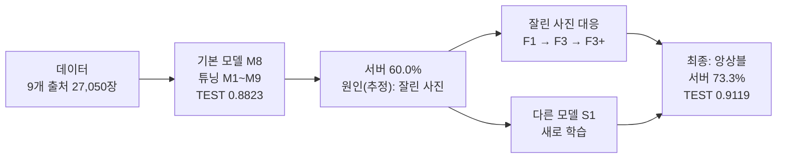

| 절 | 핵심 |
|---|---|
| 1. 과제와 데이터 | 9개 출처를 모아 정리한 27,050장 |
| 2. 기본 모델 M8 | 한 번에 하나씩 바꾸는 튜닝 → 반전·회전, epoch 60 |
| 3. 서버에서 막힌 이유 | 저해상도가 아니라 **물체가 잘린 사진** |
| 4. 잘린 사진 대응 (F1~F3+) | **넓은 자르기**가 가장 큰 효과 |
| 5. S1과 앙상블 | **다른 실수를 하는 모델**을 새로 학습해 합침 |
| 6. 최종 결과 | 서버 60.0% → 73.3%, TEST 0.8823 → 0.9119 |
| 7~8. 한계, 파일 | |

---

## 1. 과제와 데이터
▶ **핵심**: Kaggle 사진(깨끗한 배경)만 학습하면 실제 환경 사진을 거의 못 맞혀(0.14~0.19), 촬영 환경이 다른 9개 출처를 모아 27,050장으로 늘리고 중복·라벨 오류를 정리했다.

### 1-1. 과제와 조건
- 사진 한 장을 12개 클래스(battery, biological, brown-glass, cardboard, clothes, green-glass, metal, paper, plastic, shoes, trash, white-glass) 중 하나로 분류한다. 평가 지표는 **Accuracy(정확도)**.
- 원본 데이터: Kaggle *Garbage Classification (12 classes)* 15,515장.
- **사전학습 모델 사용 금지**: ImageNet 등으로 미리 학습된 가중치를 쓰지 않고, 모델을 `torch.nn`으로 직접 만들어 처음부터 학습했다.
- **TEST는 모델마다 한 번만**: 튜닝과 모델 선택은 검증 데이터로만 했다. TEST는 M8을 정한 뒤 1회, 최종 모델을 정한 뒤 1회 평가했다(6-2절).

### 1-2. 어디서 가져왔나
| 데이터셋 (바로가기) | 어떤 사진인가 | 사용한 클래스 | 학습 장수 |
|---|---|---|---|
| [Kaggle Garbage Classification (12 classes)](https://www.kaggle.com/datasets/mostafaabla/garbage-classification) (원본) | 단색 배경 위 물건, 웹 사진 | 12개 전부 | 9,584 |
| [AI Hub 재활용품 분류 및 선별 데이터](https://www.aihub.or.kr/aihubdata/data/view.do?currMenu=115&topMenu=100&dataSetSn=71362) | 아스팔트·보도블록 위에서 직접 찍은 사진 | battery, 유리병 3색, metal(캔) | 5,320 |
| [RealWaste (UCI)](https://archive.ics.uci.edu/dataset/908/realwaste) | 매립지에서 찍은 실제 쓰레기 사진 | cardboard, metal, paper, plastic, biological, trash | 2,887 |
| [TrashBusters combined](https://huggingface.co/datasets/TrashBusters/combined)의 TriCascade (Hugging Face) | 음식·골판지·신문·플라스틱 사진 | biological, cardboard, paper, plastic | 2,645 |
| [Recyclable and Household Waste Classification (Kaggle)](https://www.kaggle.com/datasets/alistairking/recyclable-and-household-waste-classification) | 생활 쓰레기 실제 환경·기본 배경 사진 | trash(스티로폼), plastic, cardboard, paper, clothes, shoes 등 | 2,844 |
| [Garbage Classification V2 (Kaggle)](https://www.kaggle.com/datasets/sumn2u/garbage-classification-v2) | 생활 쓰레기 사진 | metal, paper, plastic, trash, biological | 1,640 |
| [ShoeSandalBootimages (Hugging Face)](https://huggingface.co/datasets/Andyrasika/ShoeSandalBootimages) | 흰 배경 신발 제품 사진 | shoes | 1,631 |
| [TrashBusters combined](https://huggingface.co/datasets/TrashBusters/combined)의 다양한 금속 | 냄비·호일·스프레이 캔 등 | metal | 474 |
| [clothing-dataset-small (GitHub)](https://github.com/alexeygrigorev/clothing-dataset-small) | 옷·신발 사진 (대부분 원본과 중복이라 일부만) | clothes, shoes | 25 |

각 데이터셋의 이용 조건은 바로가기 페이지를 따른다. AI Hub 사진은 이용약관(재배포 금지)에 따라 저장소와 공개 폴더에 넣지 않았다.

**왜 외부 데이터를 섞었나**: Kaggle 사진은 대부분 깨끗한 배경 위의 물건이다. 이것만 학습하면 실제 환경(바닥·매립지·실내)에서 찍은 사진을 거의 맞히지 못했다(사전 실험에서 외부 사진 정확도 0.14~0.19, 부록 참고). 그래서 촬영 환경이 다른 출처를 섞었다.

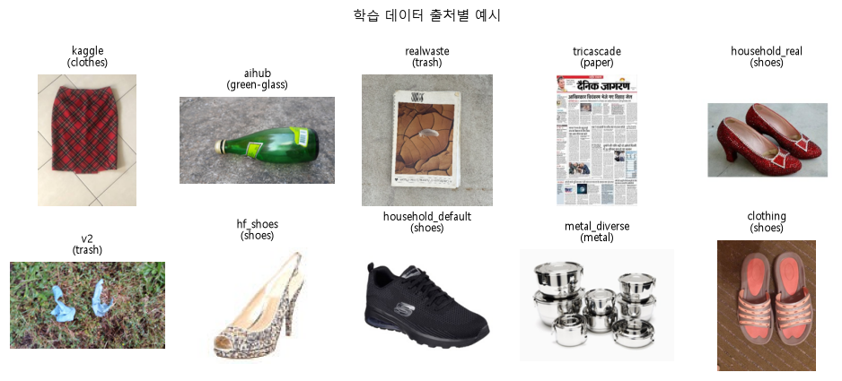

### 1-3. 클래스별 구성


| 클래스 | 장수 | 클래스 | 장수 | 클래스 | 장수 |
|---|---|---|---|---|---|
| clothes | 3,000 | plastic | 2,605 | green-glass | 1,506 |
| shoes | 3,000 | metal | 2,528 | brown-glass | 1,404 |
| biological | 2,689 | paper | 2,522 | trash | 1,580 |
| battery | 2,661 | cardboard | 2,300 | white-glass | 1,255 |

- Kaggle 원본만 쓰면 가장 많은 클래스와 적은 클래스의 차이가 **8.8배**(clothes 5,325 vs brown-glass 607)였는데, 외부 데이터를 더해 **2.4배**로 줄였다.
- Kaggle 원본은 학습용 10,860장 중 클래스당 최대 1,000장(clothes만 2,835장)을 썼다. 전체에서 Kaggle 35% : 외부 65%.

### 1-4. 어떻게 정리했나
| 정리 | 방법 | 이유 |
|---|---|---|
| 중복 제거 | 사진마다 지문(perceptual hash)을 만들어, 거의 같은 사진(해밍 거리 4 이하)을 지움. Kaggle 학습·검증·테스트 전체와 비교 | 같은 사진이 학습과 테스트에 함께 있으면 점수가 부풀려짐 |
| 라벨 오류 제거 | 사진을 직접 보고 라벨과 맞지 않는 사진 제외: 병이 너무 작거나 색이 라벨과 다른 유리병, 우유팩이 섞인 cardboard 등 | 틀린 정답으로 학습하면 모델이 헷갈림 |
| trash 정의 맞추기 | Kaggle trash(마스크·칫솔·기저귀)에 외부에서는 스티로폼 컵·용기만 추가 | 다른 클래스와 겹치는 잡다한 쓰레기를 피함 |

### 1-5. 검증·테스트 데이터
| 이름 | 장수 | 무엇인가 | 용도 |
|---|---|---|---|
| **val** | 2,327 | Kaggle 원본의 검증용 15% | 튜닝 중 성능 확인 |
| **val_ext** | 498 | 학습에 쓰지 않은 외부 실사 사진 (RealWaste 273 · AI Hub 225, 10클래스) | 다른 촬영 환경에서도 맞히는지 |
| **val_hard** | 1,198 | val 700장 + val_ext 498장에 흐림·어둡게·빛번짐을 입힌 사진 | 어려운 사진에서도 맞히는지 |
| **val_avg** | — | (val + val_ext + val_hard) / 3 | **튜닝 단계 반영 여부를 정하는 점수** |
| **test** | 2,328 | Kaggle 원본의 테스트용 15% | 최종 1회 평가 |
| **test_ext** | 360 | 학습·검증에 쓰지 않은 외부 실사 사진 (AI Hub 180 · RealWaste 180, 9클래스) | 최종 1회 평가 |

Kaggle 원본은 클래스 비율을 유지한 채 70 / 15 / 15로 나눴다(seed 42).

---

## 2. 기본 모델 M8: 전처리·증강·구조·튜닝
▶ **핵심**: 직접 구현한 18층 SmallResNet. 한 번에 한 가지만 바꾸는 튜닝(M1~M9)에서 **반전·회전 증강(+0.035)** 과 **epoch 60(+0.029)** 이 효과가 있어 M8로 정했다(TEST 0.8823). 이후 개선(3~5절)의 출발점이다.

### 2-1. 전처리 (학습·평가 공통)


| 단계 | 하는 일 | 이유 |
|---|---|---|
| 1. 192×192로 맞춤 | 원본 크기(수백~수천 px)를 모두 같은 크기로 | 크기가 제각각이면 한 번에 묶어 학습할 수 없음. 192px로 미리 저장해 두면 매번 큰 원본을 읽지 않아 빠름 |
| 2. 128×128 (모델 입력) | 한 번 더 줄임 | GPU 시간과 정확도의 균형. 160px(M9)은 오히려 흐린 사진에서 정확도가 떨어짐 |
| 3. 정규화 | 학습 데이터의 평균·표준편차로 색 값을 맞춤 (평균 [0.645, 0.621, 0.593], 표준편차 [0.261, 0.264, 0.284]) | 입력 값 범위가 일정해야 학습이 안정적 |

비율을 유지하지 않고 정사각형으로 맞췄다(물체가 조금 늘어나거나 줄어듦). 비율을 유지하고 빈 곳을 채우는 방식(letterbox, M2)도 시험했지만 결과가 나빴다(2-3).

### 2-2. M8이 쓴 증강 (최종 모델도 모두 사용)
증강은 학습 때만, 사진마다 무작위로 적용한다. 같은 사진도 epoch마다 조금씩 다른 모습으로 보게 되어, 사진을 통째로 외우지 않고 물체의 특징을 배우게 된다.


| 증강 | 설정 | 이유 | 근거 |
|---|---|---|---|
| 좌우 반전 | 확률 50% | 쓰레기는 어느 방향으로든 놓일 수 있다. 방향이 달라도 같은 물체로 보게 함 | M3에서 val_avg +0.035 |
| 상하 반전 | 확률 50% | 위에서 찍은 사진은 위아래 구분이 없음 | M3 |
| 회전 | ±20° | 비스듬히 놓이거나 기울게 찍힌 사진 대비 | M3 |
| 어둡게 또는 흐림 | 확률 50%로 둘 중 하나: 밝기 30~100% / Gaussian 흐림 | 그늘·실내 사진, 초점이 안 맞은 사진 대비 | val_hard(흐림·어두운 사진) 향상 |

반전·회전이 없던 M1·M2는 학습 정확도가 1.0까지 오르는데 val은 0.83에서 멈췄다(사진을 외움, 2-5 그림). 반전·회전을 넣은 M3부터는 학습과 검증 정확도가 함께 오른다.

### 2-3. 시험했지만 반영하지 않은 방법
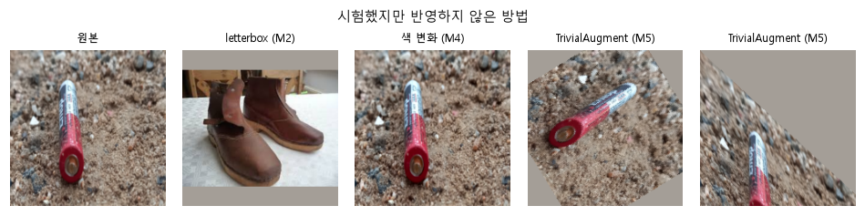

| 방법 | 결과 | 반영하지 않은 이유 |
|---|---|---|
| letterbox (비율 유지 + 빈 곳 채움, M2) | val_hard 0.766 → 0.640 | 흐리거나 어두운 사진에서 크게 떨어짐 |
| 밝기·색 변화 (M4) | val_avg 0.848 → 0.845 | 유리병 3색(brown·green·white)은 **색이 정답 단서**라 색을 흔들면 헷갈림 |
| TrivialAugmentWide (무작위 변형 1개, M5) | 0.848 → 0.836 | 이미 반전·회전으로 충분한 상태에서 변형이 너무 강함 |
| 무작위 자르기 | (M 시리즈에서 제외) | 물체가 작은 사진에서 물체가 잘려 나갈 수 있음. M8 이후 잘린 사진에 대응하려고 **넓은 자르기**로 다시 넣음 (4절) |

### 2-4. 모델 구조 (M8)
최종 모델은 이 구조에서 3·4단계에 블록을 하나씩 더한 22층이다(5절).

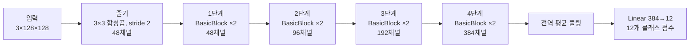

| 구성 | 설명 |
|---|---|
| BasicBlock | 3×3 합성곱 2개 + BatchNorm + ReLU, 입력을 출력에 더하는 지름길(잔차 연결). 깊어져도 학습이 잘 되게 함 |
| 단계 | 2~4단계 첫 블록에서 크기를 절반으로 줄이고 채널을 두 배로 늘림 (48 → 96 → 192 → 384) |
| 전역 평균 풀링 | 마지막 특징 지도를 채널마다 평균 → 파라미터가 적은 작은 출력층 |
| 크기 | 파라미터 6,289,212개, He 초기화 |

| 학습 설정 | 값 |
|---|---|
| 최적화 | AdamW, 학습률 0.001, weight decay 0.0001, batch 64 |
| 학습률 조절 | cosine (학습이 진행될수록 학습률을 0까지 부드럽게 줄임) |
| 손실 | CrossEntropy |
| epoch | 최대 60, 조기 종료 patience 10 (기준: (val + val_ext) / 2), 기준이 가장 좋았던 epoch의 가중치를 저장 |
| 기타 | GPU 혼합 정밀도, seed 42 |

### 2-5. 하이퍼파라미터 튜닝 (M1~M9)
#### 왜 이 순서로 진행했나
- **출발 설정**은 사전 실험(부록)에서 정했다: 모델 폭 48, cosine 학습률, 어둡게·흐림 증강, 30 epoch.
- **데이터부터** 바꿨다(M1). 사전 실험에서 외부 사진 정확도가 0.14~0.19에 그쳐 가장 큰 문제가 데이터였기 때문이다.
- 그다음 **전처리(M2) → 증강(M3~M5) → 손실(M6·M7) → 학습 길이(M8) → 입력 크기(M9)** 순으로, 앞 단계의 결과 위에서 하나씩 시험했다.

#### 규칙
- **한 단계에 한 가지만** 바꾼다. 바꾼 결과의 **val_avg가 지금까지 최고보다 0.01 이상 높으면 반영**하고, 다음 단계는 반영된 설정에서 출발한다. 아니면 되돌린다.

#### 튜닝 흐름
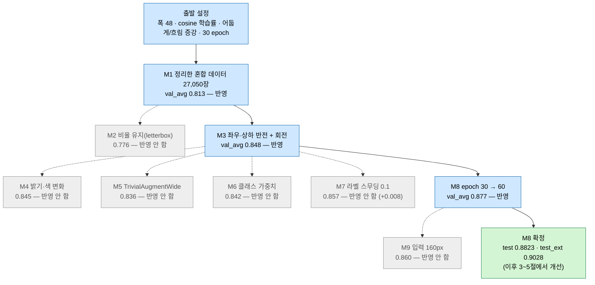
실선 = 반영되어 다음 단계의 출발점이 됨, 점선 = 시험했지만 반영하지 않음.

#### 단계별 결과
| 단계 | 바꾼 것 | val | val_ext | val_hard | val_avg | 최고 epoch | 결과 |
|---|---|---|---|---|---|---|---|
| M1 | 정리한 혼합 데이터 27,050장 | 0.834 | 0.839 | 0.766 | 0.813 | 29 | 반영 |
| M2 | 비율 유지 (letterbox) | 0.850 | 0.839 | 0.640 | 0.776 | 27 | 반영 안 함 |
| M3 | 좌우·상하 반전, 회전 | 0.859 | 0.900 | 0.786 | 0.848 | 29 | **반영** |
| M4 | 밝기·색 변화 | 0.856 | 0.894 | 0.785 | 0.845 | 29 | 반영 안 함 |
| M5 | TrivialAugmentWide | 0.838 | 0.884 | 0.787 | 0.836 | 30 | 반영 안 함 |
| M6 | 클래스 가중치 (적은 클래스의 오답에 더 큰 벌점) | 0.853 | 0.896 | 0.777 | 0.842 | 27 | 반영 안 함 |
| M7 | 라벨 스무딩 0.1 (정답 확신을 조금 낮춤) | 0.869 | 0.908 | 0.793 | 0.857 | 30 | 반영 안 함 (+0.008) |
| M8 | epoch 30 → 60 | 0.879 | 0.922 | 0.830 | **0.877** | 50 | **반영 → M8 확정** |
| M9 | 입력 128 → 160px | 0.885 | 0.914 | 0.782 | 0.860 | 58 | 반영 안 함 |

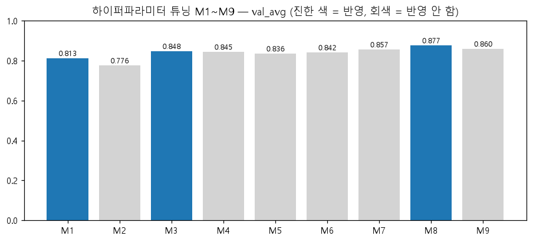

#### 단계별 epoch 곡선


#### 무엇이 효과가 있었나
1. **반전·회전 증강(M3, +0.035)**: 가장 큰 향상. M1·M2에서 학습 정확도만 1.0으로 오르던 과적합도 줄었다.
2. **epoch 30 → 60(M8, +0.029)**: 30 epoch 실험들은 마지막 몇 epoch(27~30)에서 최고 — 아직 오르는 중이었다. 60 epoch에서 세 검증 지표가 모두 올랐고, 특히 val_hard가 +0.043.
3. **효과가 없거나 나빴던 것**: letterbox와 160px는 흐린·어두운 사진에서 손해. 색 변화는 유리병 색 구분을 방해. 클래스 가중치·라벨 스무딩은 0.01 기준에 못 미침.

### 2-6. M8 학습 곡선과 과적합
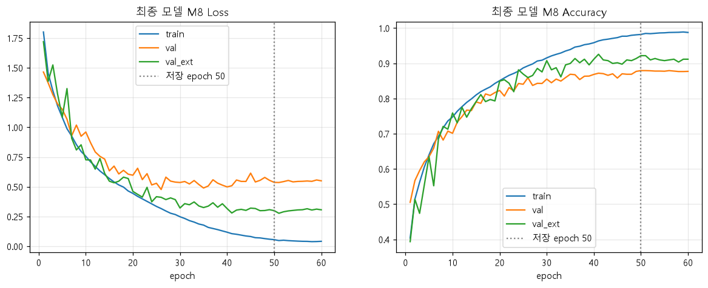
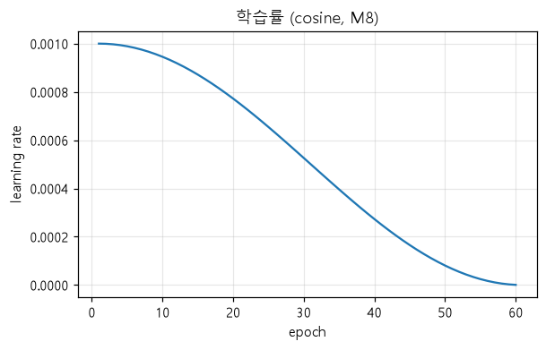

- 저장한 epoch 50에서 train 0.982 / val 0.879 (차이 0.10).
- val loss는 epoch 26(0.477)에서 가장 낮고 이후 조금 오른다(epoch 50에서 0.537). 하지만 val 정확도는 epoch 30 이후 약 0.85~0.88에서 떨어지지 않는다.
- 즉 **가벼운 과적합**: 맞히는 비율은 유지되지만, 틀린 사진을 지나치게 확신하게 된다. 정확도가 가장 좋은 epoch의 가중치를 쓴다.
- 과적합을 줄인 방법: 데이터 다양화, 증강, weight decay, BatchNorm, 작은 출력층(전역 평균 풀링), 최고 epoch 저장. Dropout은 쓰지 않았다(출력층이 Linear 하나뿐).

### 2-7. M8 TEST 결과 (1회 평가)
최종 모델의 TEST 결과는 6-2절에 있다.

| 셋 | 장수 | 정확도 |
|---|---|---|
| val / val_ext / val_hard | 2,327 / 498 / 1,198 | 0.879 / 0.922 / 0.830 |
| **test** | 2,328 | **0.8823** |
| **test_ext** | 360 | **0.9028** |

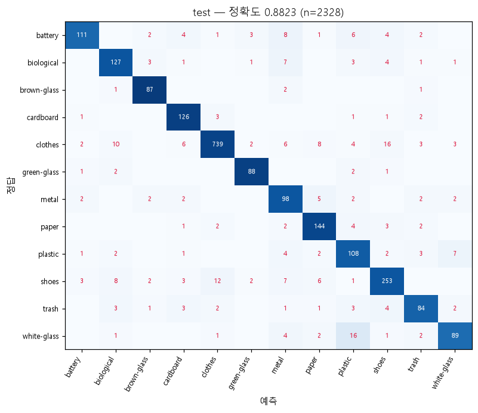


- 검증과 TEST 점수가 비슷하다(test 0.882 vs val 0.879, test_ext 0.903 vs val_ext 0.922). 검증 데이터에만 맞춰진 모델이 아니다.
- 클래스마다 정확도를 따로 구해 평균하면 0.868로, 많은 clothes(34%)가 점수를 크게 부풀리지 않았다.
- 자주 틀리는 쌍: white-glass → plastic 16장(투명 유리 vs 투명 플라스틱), battery → metal 8장, clothes ↔ shoes 16·12장, test_ext의 trash → plastic 5장(스티로폼 vs 플라스틱 용기).
- test_ext 출처별(metal 제외): AI Hub 사진 클래스(battery·유리 3색) 160장 중 154장(0.96), RealWaste 매립지 사진 클래스(cardboard·paper·plastic·trash) 160장 중 133장(0.83). 지저분한 실제 쓰레기 사진이 아직 더 어렵다.

### 2-8. 더러운 사진·배경 테스트 (M8)


- 학습한 종류의 물체만 쓰고, 어려움은 손상으로만 준 1,200장으로 추가 평가했다. 정확도 **0.773** (원본 0.826 / 손상 0.720).
- 학습에 넣은 어둡게·흐림, 그리고 흔들림·JPEG에는 비교적 버티지만, 학습에 없던 **강한 빛번짐(0.28)·저조도+잡음(0.51)·얼룩(0.60)** 에 약하다.
- 배경 의존도: 물체 바깥의 배경을 회색으로 지우면 val·val_ext 정확도가 0.122 떨어진다. 모델이 배경도 단서로 쓰고 있다는 뜻이다. 예를 들어 battery·유리 사진의 57~75%가 아스팔트 위에서 찍힌 AI Hub 사진이다.

---

## 3. 서버에서 막힌 이유
▶ **핵심**: M8은 평가 서버에서 60.0%로 검증(0.88)보다 크게 낮았다. 검증 사진으로 흉내 내 보니 저해상도는 영향이 없고 **물체가 잘리면 0.900 → 0.552로 떨어졌다** → "잘린 사진"을 개선 목표로 삼았다.

평가 서버는 사진 60장(클래스당 5장)으로 채점하며, 사진은 두 종류다.

| 서버 사진 | 장수 | M8 정확도 |
|---|---|---|
| collage_crop_upscaled (여러 물체를 붙인 큰 사진에서 한 칸을 잘라 224×224로 확대) | 42 | 52.4% |
| independent_generation (따로 만든 사진) | 18 | 77.8% |

서버 사진은 볼 수 없어, 검증 사진에 같은 조건을 흉내 내 원인을 찾았다(M8, val·val_ext 평균).

| 조건 | M8 정확도 |
|---|---|
| 원본 | 0.900 |
| 저해상도 (118~183×127로 줄였다가 224×224로 확대) | 0.899 |
| 가로·세로를 각각 70%만 남기고 자르기 (넓이 49%) | 0.769 |
| 가로·세로를 각각 50%만 남기고 자르기 (넓이 25%) | **0.552** |

**저해상도는 거의 영향이 없고(모델 입력이 128px이라 잃는 정보가 적음), 물체가 잘리면 크게 떨어졌다.** 그래서 잘린 사진을 맞히는 것을 목표로 삼았다. 이 표의 "50% 자르기"(사진마다 위치를 고정)를 아래에서 **잘린 사진 점수**로 쓴다. 서버 사진을 직접 본 것은 아니므로 원인은 추정이다.

## 4. 잘린 사진 대응: F1 → F3 → F3+
▶ **핵심**: **넓은 자르기(F1)** 가 50% 자르기를 0.552 → 0.747로 가장 크게 올렸다. 블록 2개 추가(F3, 22층)와 30 epoch 추가 학습(F3+)으로 0.790까지 올랐다.

### 4-1. 개선 흐름
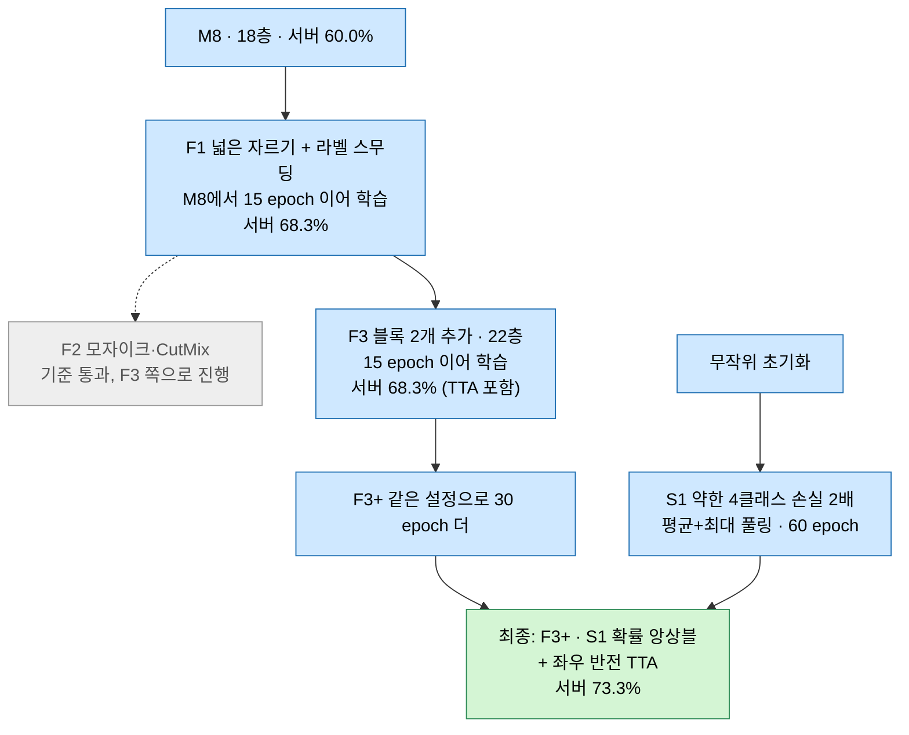
**이어 학습**: 앞 모델의 가중치에서 출발해 더 학습한다. 시작 가중치는 모두 우리가 직접 학습한 것이다(사전학습 아님). 각 단계 채택 기준(검증 사진만 사용): 잘린 사진 점수가 F1 +0.05, F2·F3 +0.02, F3+ +0.01 이상 오르고 원본 정확도가 0.01 넘게 떨어지지 않을 것. M8 대비 F1은 +0.195로 통과했다.

### 4-2. 단계별 결과 (검증, TTA 없음)
원본·70%·50%는 val·val_ext의 평균이다.

| 모델 | 바꾼 것 | 원본 | 70% 자르기 | 50% 자르기 | val_hard | val_dirty |
|---|---|---|---|---|---|---|
| M8 | — | 0.9005 | 0.7688 | 0.5518 | 0.830 | 0.755 |
| F1 | 넓은 자르기, 라벨 스무딩 0.1 | 0.9050 | 0.8571 | 0.7471 | 0.852 | 0.760 |
| F2 | F1 + 모자이크·CutMix | 0.9053 | 0.8573 | 0.7775 | 0.859 | 0.752 |
| F3 | F1 + 블록 2개 | 0.9085 | 0.8627 | 0.7719 | 0.865 | 0.774 |
| **F3+** | F3에서 30 epoch 더 | **0.9169** | **0.8775** | **0.7897** | **0.871** | **0.783** |
| S1 | 새로 학습 (5절) | 0.8623 | 0.8383 | 0.7538 | 0.784 | 0.725 |

- 가장 큰 효과는 **넓은 자르기(F1)**: 50% 자르기 0.552 → 0.747.
- F2와 F3은 모두 기준을 통과했다. 잘린 사진은 비슷하고(0.778 vs 0.772) 원본·val_hard·val_dirty는 F3이 높아 F3 쪽으로 진행했다.
- F3+는 구조·증강을 바꾸지 않고 더 학습만 해서 모든 지표가 올랐다. 따라서 F2·F3의 향상에도 **추가 학습 효과가 섞여 있을 수 있다.**
- val_dirty는 검증 사진에 잡음·JPEG·빛번짐 등 8가지 손상을 입힌 1,198장이다.

## 5. S1과 앙상블 (최종 모델)
▶ **핵심**: F1→F3→F3+는 같은 계열이라 같은 사진을 틀려 합쳐도 이득이 없었다. 출발점·풀링·증강·손실을 모두 바꾼 **S1**을 새로 학습해 확률을 섞었다(S1 비율 0.4 / 0.3). 검증 절반 B의 50% 자르기(TTA 적용)가 F3+ 0.801 → 앙상블 0.819.

### 5-1. 구조와 설정
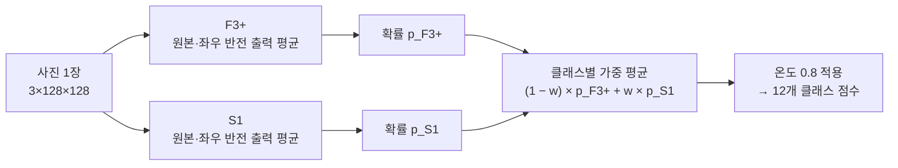

| 설정 | F3+ | S1 |
|---|---|---|
| 출발 | M8 → F1 → F3 → F3+ 순서로 이어 학습 | 무작위 초기화 (He) |
| 구조 | 줄기 + 4단계 (블록 2·2·3·3) = 합성곱 21층 + Linear = 22층, 채널 48·96·192·384 | 같음 |
| 마지막 풀링 | 전역 평균 → Linear 384→12 | **전역 평균 + 전역 최대** → Linear 768→12 |
| 파라미터 | 9,609,276 | 9,613,884 |
| 최적화 | AdamW, weight decay 0.0001, batch 64 | 같음 |
| **학습률** | **0.0003**에서 cosine으로 0 근처까지 | **0.001**에서 cosine으로 0 근처까지 |
| epoch (마지막 epoch 가중치 사용) | 30 (앞 단계: M8 50, F1 15, F3 15) | 60 |
| 손실 | CrossEntropy, 라벨 스무딩 0.1 | CrossEntropy, 라벨 스무딩 0.1, **약한 4클래스 가중치 2** |
| 증강 | M8 증강 + 넓은 자르기 | M8 증강 + 넓은 자르기 + 모자이크·CutMix |
| seed | 42 | 7 |

**학습률**: cosine은 학습률을 `lr_e = lr_0 × (1 + cos(π(e−1)/N)) / 2`로 줄인다(e: epoch, N: 총 epoch). 이어 학습할 때마다 다시 lr_0에서 시작한다. F3+는 이미 학습된 가중치를 조금만 고치려고 처음부터 학습하는 S1(0.001)의 약 1/3인 0.0003을 썼다.

**증강 추가분**
- 넓은 자르기: 절반 확률로 넓이 15~100%를 무작위로 잘라 128×128로 키움 → 잘린 물체를 학습. 원본을 그대로 보는 절반이 남아 원본 정확도를 지킴.
- 모자이크: 배치의 25%. 같은 클래스 사진 4장을 2×2로 붙인 뒤 128×128 창을 잘라냄. 라벨은 그대로.
- CutMix: 배치의 25%. 다른 사진 조각(넓이 0~50%)을 붙이고 손실을 넓이 비율로 나눔.

### 5-2. 왜 S1을 따로 학습했나
F1 → F3 → F3+는 이어 학습한 같은 계열이라 틀리는 사진이 비슷하다. 50% 자르기(검증 절반 B)에서 F3의 오답 336장 중 277장(82%)을 F3+도 틀렸다. 이런 모델끼리는 합쳐도 나아지지 않았다(F3 + F3+ 원본 0.9185 < F3+ 0.9208). S1은 출발점·seed·풀링·증강·손실을 모두 다르게 해, F3+의 오답 305장 중 S1도 틀린 것이 201장(66%)으로 줄었다.

### 5-3. 왜 평균과 최대 풀링을 같이 썼나
마지막 특징 지도(8×8)를 한 값으로 줄이는 방식이 다르다.

| 풀링 | 보는 것 | 강점 | 약점 |
|---|---|---|---|
| 평균 | 64칸 전체의 평균 반응 | 물체 전체의 모양·질감, 잡음에 강함 | 사진 일부에만 있는 단서가 묻힘 |
| 최대 | 가장 강하게 반응한 한 칸 | 뚜껑·라벨·끝부분처럼 **작게 보이는 단서**를 살림 | 반사광·배경 같은 한 점에 흔들릴 수 있음 |

잘린 사진에서는 물체의 일부만 보이므로 최대 풀링의 강점이 도움이 될 수 있고, 평균을 함께 써 약점을 보완한다. 또 F3+와 다른 방식으로 특징을 모아 **다른 실수를 하게** 하려는 목적도 있었다. 늘어난 파라미터는 Linear의 4,608개뿐이다. 단, 평균만 쓴 S1과 비교하지 않아 **풀링 하나의 효과는 따로 확인하지 않았다.**

### 5-4. 왜 trash·white-glass·metal·plastic의 손실을 2배로 줬나
S1을 설계할 때의 모델(F3 + 좌우 반전 TTA) 기준으로 **검증과 서버 모두에서 약했고, 서로 헷갈리는 묶음**이었다(metal↔plastic, white-glass→metal·plastic, trash→plastic).

| 클래스 | 50% 자르기 재현율 (검증) | 서버 정답 (/5) |
|---|---|---|
| trash | 0.623 | 2 |
| white-glass | 0.687 | 3 |
| metal | 0.717 | 3 |
| plastic | 0.732 | 3 |
| (제외) green-glass | 0.952 | 2 — 검증에서는 이미 잘 맞힘 |
| (제외) shoes | 0.645 | 5 — 서버에서 다 맞힘 |

이 4개 클래스를 고를 때 서버의 클래스별 정답 수도 참고했다. 12클래스를 모두 학습하되 **정답 라벨이 이 4개인 사진의 손실만 2배**로 해 학습이 이 클래스를 고치는 쪽으로 더 움직이게 했다. 4개만 학습하면 다른 사진까지 4개 중 하나로 확신하게 된다.

### 5-5. 손실 계산 예시
사진 n의 손실은 `−ln(정답 확률)`이고, 배치 손실은 가중치로 평균을 낸다: `Σ wₙ·(−ln pₙ) ÷ Σ wₙ` (wₙ = 2 또는 1). 사진 4장 예시 (라벨 스무딩 생략):

| 정답 | 정답 확률 p | −ln p | 가중치 w | w × (−ln p) |
|---|---|---|---|---|
| trash | 0.40 | 0.916 | 2 | 1.833 |
| clothes | 0.75 | 0.288 | 1 | 0.288 |
| metal | 0.55 | 0.598 | 2 | 1.196 |
| shoes | 0.80 | 0.223 | 1 | 0.223 |
| 합 | | 2.025 | 6 | 3.540 |

- 가중치 없음: 2.025 ÷ 4 = **0.506**. trash·metal이 손실의 75%를 차지.
- 가중치 2배: 3.540 ÷ 6 = **0.590**. trash·metal의 몫이 86%로 커짐.
- 학습 데이터 전체로 보면 4개 클래스는 사진의 29.5%(7,968장)지만 손실 가중치 합에서는 45.5%가 된다.
- 라벨 스무딩 0.1을 쓰면 목표 확률이 정답 0.9 + 0.1/12 ≈ 0.908, 나머지 클래스 각 0.1/12 ≈ 0.008이 된다. 정답을 지나치게 확신하지 않게 한다(PyTorch `CrossEntropyLoss(weight=..., label_smoothing=0.1)`).

### 5-6. 앙상블 가중치를 어떻게 정했나
`최종 확률(클래스 c) = (1 − w_c) × p_F3+(c) + w_c × p_S1(c)`
- **w = 0.4 (약한 4클래스), 0.3 (나머지 8클래스)**. 비율을 두 개만 둬 검증 사진에 지나치게 맞추지 않게 했다.
- 검증 사진(val·val_ext 2,825장)을 경로로 정해진 두 절반(A 1,381장, B 1,444장)으로 나눴다. A에서 0~1을 0.1 간격으로 121개 조합을 비교해 원본·50% 자르기 평균 정확도가 가장 높은 비율을 골랐고, B에서 확인했다. **서버 점수로 비율을 고르지 않았다.**
- 온도 0.8: 확률의 로그를 0.8로 나눠 조금 더 확신 있게 만든다. 예측 클래스는 바뀌지 않고 손실만 바뀐다. 0.65가 검증 손실은 더 낮았지만, 정확도 64% 정도의 어려운 사진을 흉내 냈을 때 손실이 오히려 커져 0.8로 정했다.

예시: 어떤 사진에서 F3+가 plastic 0.45 · trash 0.40, S1이 trash 0.60 · plastic 0.25라면
- trash: 0.6 × 0.40 + 0.4 × 0.60 = **0.48**
- plastic: 0.6 × 0.45 + 0.4 × 0.25 = 0.37 → F3+ 혼자는 plastic, 합치면 **trash**.

| 검증 절반 B (좌우 반전 TTA) | 원본 | 70% 자르기 | 50% 자르기 | 50% 자르기 손실 |
|---|---|---|---|---|
| F3+ | 0.9208 | 0.8814 | 0.8014 | 0.658 |
| S1 | 0.8658 | 0.8358 | 0.7661 | 0.814 |
| **F3+ · S1 (온도 0.8)** | **0.9208** | **0.8854** | **0.8192** | **0.568** |

- 원본은 같고, 50% 자르기는 +0.018 (95% 구간 +0.005~+0.032).
- 약한 4클래스의 50% 자르기 재현율 평균 0.701 → 0.736, 나머지 8클래스 0.807 → 0.810.

---

## 6. 최종 결과
▶ **핵심**: 평가 서버 60.0% → **73.3%**, TEST 0.8823 → **0.9119**. 서버에서 늘어난 정답은 손실을 키운 trash·metal이지만, 60장이라 우연과 구분하기 어렵다.

### 6-1. 평가 서버 (60장)
| 모델 | 전체 | 손실 | collage (42) | independent (18) |
|---|---|---|---|---|
| M8 | 36 (60.0%) | 1.680 | 22 | 14 |
| F1 | 41 (68.3%) | 1.054 | 26 | **15** |
| F3 + 좌우 반전 TTA | 41 (68.3%) | 1.018 | 27 | 14 |
| **최종 (F3+ · S1)** | **44 (73.3%)** | **0.963** | **30** | 14 |

| 클래스 (/5) | battery | biological | brown-glass | cardboard | clothes | green-glass | metal | paper | plastic | shoes | trash | white-glass |
|---|---|---|---|---|---|---|---|---|---|---|---|---|
| M8 | 2 | 5 | 3 | 4 | 2 | 2 | 3 | 4 | 3 | 5 | 1 | 2 |
| 최종 | 4 | 5 | 3 | 4 | 3 | 2 | 4 | 4 | 3 | 5 | 4 | 3 |

- F3 + TTA보다 늘어난 3장은 **trash +2, metal +1**로 손실을 키운 클래스다. 다만 60장은 1장이 1.7%p라 우연과 구분하기 어렵고, 손실 2배를 뺀 같은 모델과 비교하지 않아 **손실 2배의 효과라고 단정할 수 없다.**
- 서버 제출은 4번(M8, F1, F3 + TTA, 최종) 했고, 최종 모델은 서버 결과를 보고 골랐다. M8의 white-glass(2)는 전체 정답 수에서 계산한 값이다.

### 6-2. TEST (1회 평가)
최종 모델이 정해진 뒤 TEST를 한 번 평가했다. TEST는 M8과 최종 모델에 각각 1번씩만 썼고, 모델을 고르는 데는 쓰지 않았다.

| 셋 | 장수 | M8 | **최종 모델** |
|---|---|---|---|
| test (Kaggle 원본) | 2,328 | 0.8823 (2,054장) | **0.9119** (2,123장) |
| test_ext (외부 실사) | 360 | 0.9028 (325장) | **0.9111** (328장) |

- 최종 모델의 클래스별 정확도 평균: test 0.902, test_ext 0.911. 손실: test 0.327, test_ext 0.286.
- test에서 많이 오른 클래스: trash 0.808 → 0.904, metal 0.852 → 0.922, plastic 0.831 → 0.885, paper 0.911 → 0.949. white-glass는 0.767 → 0.776으로 거의 그대로다.
- 아직 자주 틀리는 쌍(test): white-glass → plastic 17장, clothes → shoes 14장, shoes → clothes 9장, battery → metal 8장. test_ext는 +3장이라 차이가 작다.
- 추론은 모델 2개 × 사진 2장(원본·반전)으로 모델을 4번 돌린다(로컬 CPU에서 한 장 약 0.17초).

### 6-3. 시험했지만 쓰지 않은 방법
| 방법 | 결과 | 쓰지 않은 이유 |
|---|---|---|
| 손상 증강 N1 (잡음·JPEG·빛번짐·얼룩·저조도) | val_avg4 +0.008 | 기준(+0.01) 미달 |
| 출력층을 MLP로 (M8 특징으로 시험) | Linear 0.878 vs MLP 0.875 | 더 나아지지 않음 |
| F1·F3·F3+끼리 앙상블 | F3+ 단독 이하 | 틀리는 사진이 비슷함 |
| 클래스당 5장이라는 서버 구성을 이용한 답 재배정 | — | 평가셋 구성을 쓰는 방법이라 쓰지 않음. 사진을 한 장씩 받는 서버에서는 오히려 손해 (모의 실험) |

## 7. 한계
- 실험마다 seed 하나로 돌려, 0.01 안쪽의 차이는 우연과 구분하기 어렵다. 평가 서버는 60장이라 1장이 1.7%p다.
- val·val_ext를 F1부터 최종 모델까지 계속 모델 선택에 썼기 때문에 검증 점수는 조금 낙관적일 수 있다. TEST는 모델 선택에 쓰지 않았다.
- "약한 클래스 손실 2배"와 "평균+최대 풀링" 각각의 효과는 따로 확인하지 않았다(빼고 학습한 모델과 비교하지 않음).
- 서버 collage 정확도(71.4%)는 검증의 50% 자르기(0.819)보다 낮다. 서버 사진의 다른 차이(생성 이미지의 화풍 등)를 흉내 내지 못한 것으로 보인다(추정).
- 강한 빛번짐·잡음에 약하고 배경에 기대는 경향은 M8에서 확인했다(2-8절). 손상 증강(N1)은 기준에 못 미쳤다.
- paper 학습 사진은 신문·잡지 같은 글자 인쇄물이 대부분이라, 글자가 거의 없는 종이는 덜 맞힌다(검증 사진 직접 분류: 0.950 vs 0.864, `01_coding/RESULT/analysis/`).
- test_ext에는 biological·clothes·shoes 외부 사진이 없다.

## 8. 파일 찾기와 실행
| 경로 | 내용 |
|---|---|
| `01_coding/notebooks/final_model.ipynb` | 분석 전 과정: 데이터 분할·통합·정리 → 전처리·증강 → 모델 → 학습 → 튜닝 → 최종 평가 (출력 포함) |
| `01_coding/notebooks/test.ipynb` | M8로 TEST 정확도·혼동행렬만 확인 |
| `01_coding/notebooks/final_model.ipynb` 9-2~9-5절 (README 4절) | F1·F2·F3·F3+ 이어 학습 (`RUN_FINETUNE`, `RUN_F2`, `RUN_F3`, `RUN_F3P` 스위치) |
| `01_coding/notebooks/s1_model.ipynb` | S1 학습과 F3 · S1 앙상블 평가 |
| `01_coding/submission/f3p_s1/model.py` | **최종 모델** 제출 파일 (앙상블·TTA·온도 포함). 가중치 `weights.pt`(77MB)는 저장소에 없음 (아래) |
| `01_coding/submission/` 의 다른 폴더 | 이전 제출 파일: `model.py`(M8·F1), `f3/`, `f3_tta/` |
| `01_coding/tools/evaluate_final.py` | 최종 모델 TEST 1회 평가 (결과가 있으면 다시 평가하지 않음) |
| `01_coding/model/` | M8 가중치 `final_model.pth`, 설정 `config.json`, 모델 설명 |
| `01_coding/RESULT/experiments/` | 실험마다 설정(`cfg.json`)·epoch별 기록(`history.csv`)·지표(`metrics.json`). M1~M9는 `M*/`와 `ladder_m.csv`, M8 이후는 `F1/`·`F2/`·`F3/`·`F3P_30ep/`·`S1/`(잘린 사진 점수 `crop_report.csv`), 앙상블 비율은 `F3P_S1_ensemble/` |
| `01_coding/RESULT/final_test/` | TEST 1회 평가 결과와 혼동행렬 (M8: `final_test*`, 최종 모델: `*_f3p_s1*`), 더러운 사진 평가 예측 |
| `01_coding/RESULT/data_split/` | 학습·검증·테스트 사진 목록 CSV |
| `01_coding/RESULT/figures/` | 이 보고서의 그림 |
| `01_coding/tools/` | 데이터 수집·정리 스크립트 (기록용) |

**실행**: Colab(GPU)에서 노트북을 열고 위에서부터 실행하면 Google Drive 공개 폴더에서 데이터를 받는다. 저장된 실험 결과를 읽으므로 다시 학습하지 않는다. 성능만 확인하려면 `test.ipynb`.

**최종 모델 가중치 만들기**: Drive 공개 폴더의 `experiments/F3P_30ep/best.pth`와 `experiments/S1/best.pth`를 받아 하나로 합친다.
```python
import torch
w = {f"{n}.{k}": v for n, p in [("f3p", "F3P_30ep/best.pth"), ("s1", "S1/best.pth")]
     for k, v in torch.load(p, map_location="cpu", weights_only=True).items()}
torch.save(w, "01_coding/submission/f3p_s1/weights.pt")
```

---

---

## 부록. 출발 설정을 정한 사전 실험
M 시리즈 이전에, Kaggle 원본만(학습 7,749장, 클래스당 최대 1,000장)으로 같은 방식의 튜닝 12단계를 먼저 했다(`experiments/R*`, `ladder.csv`). 여기서 모델 폭(32 → 48), cosine 학습률, 어둡게·흐림 증강을 반영했고, 학습률(1e-3 vs 3e-3)·weight decay(1e-4 vs 5e-4)·MLP 출력층·epoch 100 등은 효과가 없어 기본값을 유지했다. 이 실험에서 Kaggle 사진만 학습하면 외부 사진 정확도가 0.14~0.19에 그친다는 것을 확인했고(외부 사진을 섞은 단계는 0.77), 데이터를 모아 정리한 M 시리즈로 넘어갔다. 검증 데이터가 정리 전후로 달라 M 시리즈와 숫자를 직접 비교하지 않는다.
