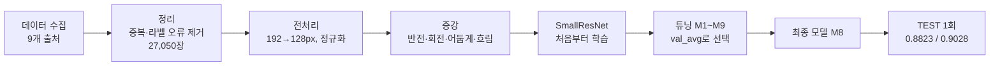
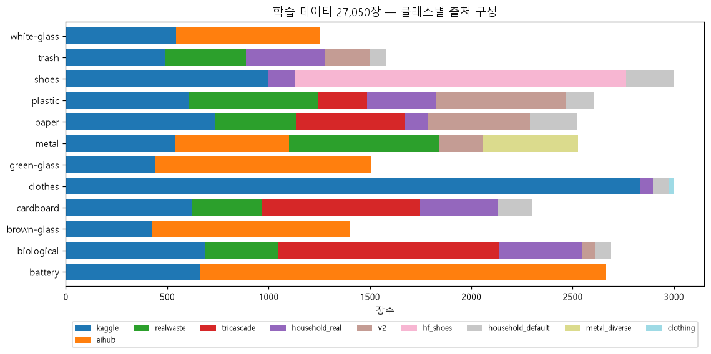
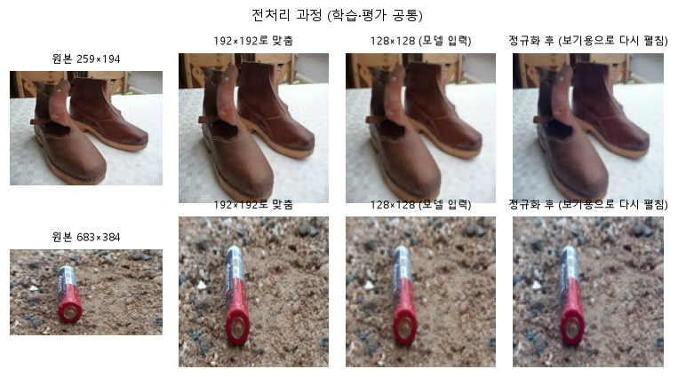
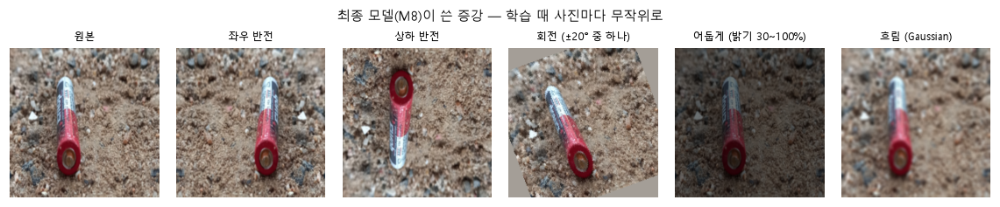
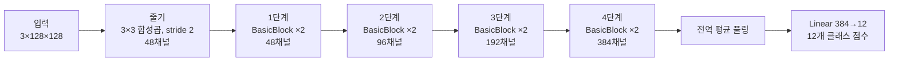
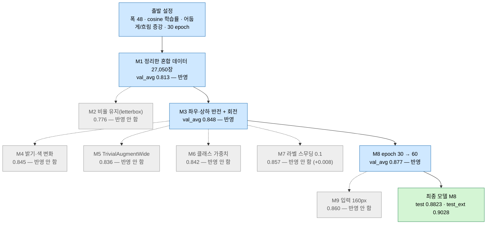
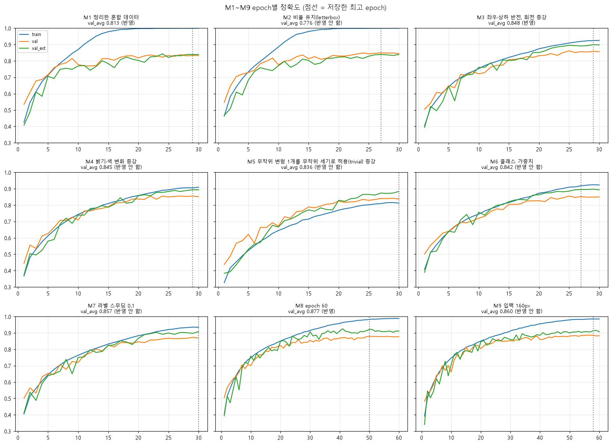
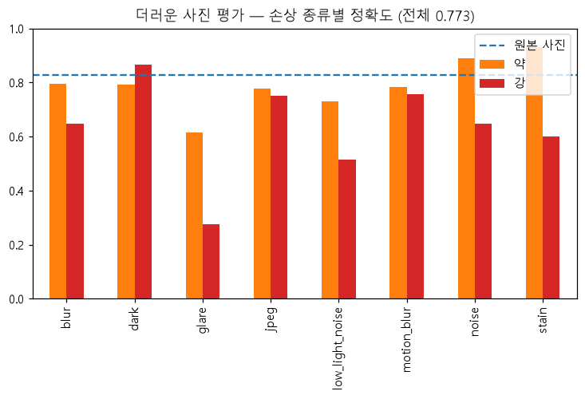

# 쓰레기 이미지 12종 분류 — 해커톤 보고서

> 쓰레기 사진 한 장을 보고 12종류 중 무엇인지 맞히는 모델을 만들었다. **사전학습 모델 없이** 작은 ResNet을 직접 구현해 처음부터 학습했다.

## 0. 한눈에 보기

| 항목 | 내용 |
|---|---|
| 분류할 클래스 (12) | battery, biological, brown-glass, cardboard, clothes, green-glass, metal, paper, plastic, shoes, trash, white-glass |
| 학습 데이터 | 9개 출처를 모아 정리한 27,050장 |
| 모델 | SmallResNet (직접 구현, 파라미터 6,289,212개, 입력 128×128) |
| 튜닝 | M1~M9: 한 번에 하나씩 바꿔 보고 좋아지면 반영 |
| 최종 모델 | **M8** (`01_coding/model/`) |
| **최종 TEST 정확도** | **test 0.8823** (Kaggle 사진 2,328장) · **test_ext 0.9028** (외부 실사 사진 360장) |

---

## 1. 과제와 조건
- 사진 한 장을 12개 클래스 중 하나로 분류한다. 평가 지표는 **Accuracy(정확도)**.
- 원본 데이터: Kaggle *Garbage Classification (12 classes)* 15,515장.
- **사전학습 모델 사용 금지**: ImageNet 등으로 미리 학습된 가중치를 쓰지 않고, 모델을 `torch.nn`으로 직접 만들어 처음부터 학습했다.
- **TEST는 한 번만**: 튜닝과 모델 선택은 검증 데이터로만 하고, 최종 모델이 정해진 뒤 TEST를 1회 평가했다.

## 2. 데이터

### 2-1. 어디서 가져왔나
| 데이터셋 | 어떤 사진인가 | 사용한 클래스 | 학습 장수 |
|---|---|---|---|
| Kaggle Garbage Classification (원본) | 단색 배경 위 물건, 웹 사진 | 12개 전부 | 9,584 |
| AI Hub 재활용품 분류 및 선별 데이터 | 아스팔트·보도블록 위에서 직접 찍은 사진 | battery, 유리병 3색, metal(캔) | 5,320 |
| RealWaste (UCI) | 매립지에서 찍은 실제 쓰레기 사진 | cardboard, metal, paper, plastic, biological, trash | 2,887 |
| TrashBusters TriCascade (Hugging Face) | 음식·골판지·신문·플라스틱 사진 | biological, cardboard, paper, plastic | 2,645 |
| Recyclable and Household Waste (Kaggle) | 생활 쓰레기 실제 환경·기본 배경 사진 | trash(스티로폼), plastic, cardboard, paper, clothes, shoes 등 | 2,844 |
| Garbage Classification V2 (Kaggle) | 생활 쓰레기 사진 | metal, paper, plastic, trash, biological | 1,640 |
| ShoeSandalBoot (Hugging Face) | 흰 배경 신발 제품 사진 | shoes | 1,631 |
| TrashBusters 다양한 금속 | 냄비·호일·스프레이 캔 등 | metal | 474 |
| clothing-dataset-small | 옷·신발 사진 (대부분 원본과 중복이라 일부만) | clothes, shoes | 25 |

**왜 외부 데이터를 섞었나**: Kaggle 사진은 대부분 깨끗한 배경 위의 물건이다. 이것만 학습하면 실제 환경(바닥·매립지·실내)에서 찍은 사진을 거의 맞히지 못했다(사전 실험에서 외부 사진 정확도 0.14~0.19, 부록 참고). 그래서 촬영 환경이 다른 출처를 섞었다.

### 2-2. 클래스별 구성

| 클래스 | 장수 | 클래스 | 장수 | 클래스 | 장수 |
|---|---|---|---|---|---|
| clothes | 3,000 | plastic | 2,605 | green-glass | 1,506 |
| shoes | 3,000 | metal | 2,528 | brown-glass | 1,404 |
| biological | 2,689 | paper | 2,522 | trash | 1,580 |
| battery | 2,661 | cardboard | 2,300 | white-glass | 1,255 |

- Kaggle 원본만 쓰면 가장 많은 클래스와 적은 클래스의 차이가 **8.8배**(clothes 5,325 vs brown-glass 607)였는데, 외부 데이터를 더해 **2.4배**로 줄였다.
- Kaggle 원본은 학습용 10,860장 중 클래스당 최대 1,000장(clothes만 2,835장)을 썼다. 전체에서 Kaggle 35% : 외부 65%.

### 2-3. 어떻게 정리했나
| 정리 | 방법 | 이유 |
|---|---|---|
| 중복 제거 | 사진마다 지문(perceptual hash)을 만들어, 거의 같은 사진(해밍 거리 4 이하)을 지움. Kaggle 학습·검증·테스트 전체와 비교 | 같은 사진이 학습과 테스트에 함께 있으면 점수가 부풀려짐 |
| 라벨 오류 제거 | 사진을 직접 보고 라벨과 맞지 않는 사진 제외: 병이 너무 작거나 색이 라벨과 다른 유리병, 우유팩이 섞인 cardboard 등 | 틀린 정답으로 학습하면 모델이 헷갈림 |
| trash 정의 맞추기 | Kaggle trash(마스크·칫솔·기저귀)에 외부에서는 스티로폼 컵·용기만 추가 | 다른 클래스와 겹치는 잡다한 쓰레기를 피함 |

### 2-4. 검증·테스트 데이터
| 이름 | 장수 | 무엇인가 | 용도 |
|---|---|---|---|
| **val** | 2,327 | Kaggle 원본의 검증용 15% | 튜닝 중 성능 확인 |
| **val_ext** | 498 | 학습에 쓰지 않은 외부 실사 사진 (RealWaste 273 · AI Hub 225, 10클래스) | 다른 촬영 환경에서도 맞히는지 |
| **val_hard** | 1,198 | val 700장 + val_ext 498장에 흐림·어둡게·빛번짐을 입힌 사진 | 어려운 사진에서도 맞히는지 |
| **val_avg** | — | (val + val_ext + val_hard) / 3 | **튜닝 단계 반영 여부를 정하는 점수** |
| **test** | 2,328 | Kaggle 원본의 테스트용 15% | 최종 1회 평가 |
| **test_ext** | 360 | 학습·검증에 쓰지 않은 외부 실사 사진 (AI Hub 180 · RealWaste 180, 9클래스) | 최종 1회 평가 |

Kaggle 원본은 클래스 비율을 유지한 채 70 / 15 / 15로 나눴다(seed 42).

## 3. 전처리와 증강 — 무엇을, 왜

### 3-1. 전처리 (학습·평가 공통)

| 단계 | 하는 일 | 이유 |
|---|---|---|
| 1. 192×192로 맞춤 | 원본 크기(수백~수천 px)를 모두 같은 크기로 | 크기가 제각각이면 한 번에 묶어 학습할 수 없음. 192px로 미리 저장해 두면 매번 큰 원본을 읽지 않아 빠름 |
| 2. 128×128 (모델 입력) | 한 번 더 줄임 | GPU 시간과 정확도의 균형. 160px(M9)은 오히려 흐린 사진에서 정확도가 떨어짐 |
| 3. 정규화 | 학습 데이터의 평균·표준편차로 색 값을 맞춤 (평균 [0.645, 0.621, 0.593], 표준편차 [0.261, 0.264, 0.284]) | 입력 값 범위가 일정해야 학습이 안정적 |

비율을 유지하지 않고 정사각형으로 맞췄다(물체가 조금 늘어나거나 줄어듦). 비율을 유지하고 빈 곳을 채우는 방식(letterbox, M2)도 시험했지만 결과가 나빴다(3-3).

### 3-2. 최종 모델(M8)이 쓴 증강
증강은 학습 때만, 사진마다 무작위로 적용한다. 같은 사진도 epoch마다 조금씩 다른 모습으로 보게 되어, 사진을 통째로 외우지 않고 물체의 특징을 배우게 된다.

| 증강 | 설정 | 이유 | 근거 |
|---|---|---|---|
| 좌우 반전 | 확률 50% | 쓰레기는 어느 방향으로든 놓일 수 있다. 방향이 달라도 같은 물체로 보게 함 | M3에서 val_avg +0.035 |
| 상하 반전 | 확률 50% | 위에서 찍은 사진은 위아래 구분이 없음 | M3 |
| 회전 | ±20° | 비스듬히 놓이거나 기울게 찍힌 사진 대비 | M3 |
| 어둡게 또는 흐림 | 확률 50%로 둘 중 하나: 밝기 30~100% / Gaussian 흐림 | 그늘·실내 사진, 초점이 안 맞은 사진 대비 | val_hard(흐림·어두운 사진) 향상 |

반전·회전이 없던 M1·M2는 학습 정확도가 1.0까지 오르는데 val은 0.83에서 멈췄다(사진을 외움, 5-4 그림). 반전·회전을 넣은 M3부터는 학습과 검증 정확도가 함께 오른다.

### 3-3. 시험했지만 반영하지 않은 방법

| 방법 | 결과 | 반영하지 않은 이유 |
|---|---|---|
| letterbox (비율 유지 + 빈 곳 채움, M2) | val_hard 0.766 → 0.640 | 흐리거나 어두운 사진에서 크게 떨어짐 |
| 밝기·색 변화 (M4) | val_avg 0.848 → 0.845 | 유리병 3색(brown·green·white)은 **색이 정답 단서**라 색을 흔들면 헷갈림 |
| TrivialAugmentWide (무작위 변형 1개, M5) | 0.848 → 0.836 | 이미 반전·회전으로 충분한 상태에서 변형이 너무 강함 |
| 무작위 자르기 | (설계 단계에서 제외) | 물체가 작은 사진에서 물체가 잘려 나갈 수 있음 |

## 4. 모델

| 구성 | 설명 |
|---|---|
| BasicBlock | 3×3 합성곱 2개 + BatchNorm + ReLU, 입력을 출력에 더하는 지름길(잔차 연결). 깊어져도 학습이 잘 되게 함 |
| 단계 | 2~4단계 첫 블록에서 크기를 절반으로 줄이고 채널을 두 배로 늘림 (48 → 96 → 192 → 384) |
| 전역 평균 풀링 | 마지막 특징 지도를 채널마다 평균 → 파라미터가 적은 작은 출력층 |
| 크기 | 파라미터 6,289,212개, He 초기화 |

| 학습 설정 | 값 |
|---|---|
| 최적화 | AdamW, 학습률 0.001, weight decay 0.0001, batch 64 |
| 학습률 조절 | cosine (학습이 진행될수록 학습률을 0까지 부드럽게 줄임) |
| 손실 | CrossEntropy |
| epoch | 최대 60, 조기 종료 patience 10 (기준: (val + val_ext) / 2), 기준이 가장 좋았던 epoch의 가중치를 저장 |
| 기타 | GPU 혼합 정밀도, seed 42 |

## 5. 하이퍼파라미터 튜닝 (M1~M9)

### 5-1. 규칙
- 출발 설정: 모델 폭 48, cosine 학습률, 어둡게·흐림 증강, 30 epoch (사전 실험으로 정함, 부록).
- **한 단계에 한 가지만** 바꾼다. 바꾼 결과의 **val_avg가 지금까지 최고보다 0.01 이상 높으면 반영**하고, 다음 단계는 반영된 설정에서 출발한다. 아니면 되돌린다.

### 5-2. 튜닝 흐름

실선 = 반영되어 다음 단계의 출발점이 됨, 점선 = 시험했지만 반영하지 않음.

### 5-3. 단계별 결과
| 단계 | 바꾼 것 | val | val_ext | val_hard | val_avg | 최고 epoch | 결과 |
|---|---|---|---|---|---|---|---|
| M1 | 정리한 혼합 데이터 27,050장 | 0.834 | 0.839 | 0.766 | 0.813 | 29 | 반영 |
| M2 | 비율 유지 (letterbox) | 0.850 | 0.839 | 0.640 | 0.776 | 27 | 반영 안 함 |
| M3 | 좌우·상하 반전, 회전 | 0.859 | 0.900 | 0.786 | 0.848 | 29 | **반영** |
| M4 | 밝기·색 변화 | 0.856 | 0.894 | 0.785 | 0.845 | 29 | 반영 안 함 |
| M5 | TrivialAugmentWide | 0.838 | 0.884 | 0.787 | 0.836 | 30 | 반영 안 함 |
| M6 | 클래스 가중치 (적은 클래스의 오답에 더 큰 벌점) | 0.853 | 0.896 | 0.777 | 0.842 | 27 | 반영 안 함 |
| M7 | 라벨 스무딩 0.1 (정답 확신을 조금 낮춤) | 0.869 | 0.908 | 0.793 | 0.857 | 30 | 반영 안 함 (+0.008) |
| M8 | epoch 30 → 60 | 0.879 | 0.922 | 0.830 | **0.877** | 50 | **반영 → 최종** |
| M9 | 입력 128 → 160px | 0.885 | 0.914 | 0.782 | 0.860 | 58 | 반영 안 함 |

### 5-4. 단계별 epoch 곡선

### 5-5. 무엇이 효과가 있었나
1. **반전·회전 증강(M3, +0.035)**: 가장 큰 향상. M1·M2에서 학습 정확도만 1.0으로 오르던 과적합도 줄었다.
2. **epoch 30 → 60(M8, +0.029)**: 30 epoch 실험들은 마지막 몇 epoch(27~30)에서 최고 — 아직 오르는 중이었다. 60 epoch에서 세 검증 지표가 모두 올랐고, 특히 val_hard가 +0.043.
3. **효과가 없거나 나빴던 것**: letterbox와 160px는 흐린·어두운 사진에서 손해. 색 변화는 유리병 색 구분을 방해. 클래스 가중치·라벨 스무딩은 0.01 기준에 못 미침.

## 6. 최종 모델(M8) 학습 곡선과 과적합

- 저장한 epoch 50에서 train 0.982 / val 0.879 (차이 0.10).
- val loss는 epoch 26(0.477)에서 가장 낮고 이후 조금 오른다(epoch 50에서 0.537). 하지만 val 정확도는 epoch 30 이후 약 0.85~0.88에서 떨어지지 않는다.
- 즉 **가벼운 과적합**: 맞히는 비율은 유지되지만, 틀린 사진을 지나치게 확신하게 된다. 정확도가 가장 좋은 epoch의 가중치를 쓴다.
- 과적합을 줄인 방법: 데이터 다양화, 증강, weight decay, BatchNorm, 작은 출력층(전역 평균 풀링), 최고 epoch 저장. Dropout은 쓰지 않았다(출력층이 Linear 하나뿐).

## 7. 최종 TEST 결과 (M8, 1회 평가)
| 셋 | 장수 | 정확도 |
|---|---|---|
| val / val_ext / val_hard | 2,327 / 498 / 1,198 | 0.879 / 0.922 / 0.830 |
| **test** | 2,328 | **0.8823** |
| **test_ext** | 360 | **0.9028** |

- 검증과 TEST 점수가 비슷하다(test 0.882 vs val 0.879, test_ext 0.903 vs val_ext 0.922). 검증 데이터에만 맞춰진 모델이 아니다.
- 클래스마다 정확도를 따로 구해 평균하면 0.868로, 많은 clothes(34%)가 점수를 크게 부풀리지 않았다.
- 자주 틀리는 쌍: white-glass → plastic 16장(투명 유리 vs 투명 플라스틱), battery → metal 8장, clothes ↔ shoes 16·12장, test_ext의 trash → plastic 5장(스티로폼 vs 플라스틱 용기).
- test_ext 출처별(metal 제외): AI Hub 사진 클래스(battery·유리 3색) 160장 중 154장(0.96), RealWaste 매립지 사진 클래스(cardboard·paper·plastic·trash) 160장 중 133장(0.83). 지저분한 실제 쓰레기 사진이 아직 더 어렵다.

## 8. 더러운 사진·배경 테스트

- 학습한 종류의 물체만 쓰고, 어려움은 손상으로만 준 1,200장으로 추가 평가했다. 정확도 **0.773** (원본 0.826 / 손상 0.720).
- 학습에 넣은 어둡게·흐림, 그리고 흔들림·JPEG에는 비교적 버티지만, 학습에 없던 **강한 빛번짐(0.28)·저조도+잡음(0.51)·얼룩(0.60)** 에 약하다.
- 배경 의존도: 물체 바깥의 배경을 회색으로 지우면 val·val_ext 정확도가 0.122 떨어진다. 모델이 배경도 단서로 쓰고 있다는 뜻이다. 예를 들어 battery·유리 사진의 57~75%가 아스팔트 위에서 찍힌 AI Hub 사진이다.

## 9. 한계와 다음 과제
- 실험마다 seed 하나로 돌려, 0.01 안쪽의 차이는 우연과 구분하기 어렵다.
- 강한 빛번짐·잡음에 약하고 배경에 기대는 경향이 있다 → 노이즈 증강과 배경 교란 증강으로 추가 실험 중.
- paper 학습 사진은 신문·잡지 같은 글자 인쇄물이 대부분이라, 글자가 거의 없는 종이는 덜 맞힌다(검증 사진 직접 분류: 0.950 vs 0.864, `01_coding/RESULT/analysis/`).
- test_ext에는 biological·clothes·shoes 외부 사진이 없다.

## 10. 파일 찾기와 실행
| 경로 | 내용 |
|---|---|
| `01_coding/notebooks/final_model.ipynb` | 분석 전 과정: 데이터 분할·통합·정리 → 전처리·증강 → 모델 → 학습 → 튜닝 → 최종 평가 (출력 포함) |
| `01_coding/notebooks/test.ipynb` | 최종 모델로 TEST 정확도·혼동행렬만 확인 |
| `01_coding/model/` | 최종 가중치 `final_model.pth`, 설정 `config.json`, 모델 설명 |
| `01_coding/RESULT/experiments/` | 실험마다 설정(`cfg.json`)·epoch별 기록(`history.csv`)·지표(`metrics.json`). M1~M9는 `M*/`와 `ladder_m.csv` |
| `01_coding/RESULT/final_test/` | TEST 1회 평가 결과와 혼동행렬, 더러운 사진 평가 예측 |
| `01_coding/RESULT/data_split/` | 학습·검증·테스트 사진 목록 CSV |
| `01_coding/RESULT/figures/` | 이 보고서의 그림 |
| `01_coding/tools/` | 데이터 수집·정리 스크립트 (기록용) |

**실행**: Colab(GPU)에서 노트북을 열고 위에서부터 실행하면 Google Drive 공개 폴더에서 데이터를 받는다. 저장된 실험 결과를 읽으므로 다시 학습하지 않는다. 성능만 확인하려면 `test.ipynb`.

---

## 부록. 출발 설정을 정한 사전 실험
M 시리즈 이전에, Kaggle 원본만(학습 7,749장, 클래스당 최대 1,000장)으로 같은 방식의 튜닝 12단계를 먼저 했다(`experiments/R*`, `ladder.csv`). 여기서 모델 폭(32 → 48), cosine 학습률, 어둡게·흐림 증강을 반영했고, 학습률(1e-3 vs 3e-3)·weight decay(1e-4 vs 5e-4)·MLP 출력층·epoch 100 등은 효과가 없어 기본값을 유지했다. 이 실험에서 Kaggle 사진만 학습하면 외부 사진 정확도가 0.14~0.19에 그친다는 것을 확인했고(외부 사진을 섞은 단계는 0.77), 데이터를 모아 정리한 M 시리즈로 넘어갔다. 검증 데이터가 정리 전후로 달라 M 시리즈와 숫자를 직접 비교하지 않는다.
