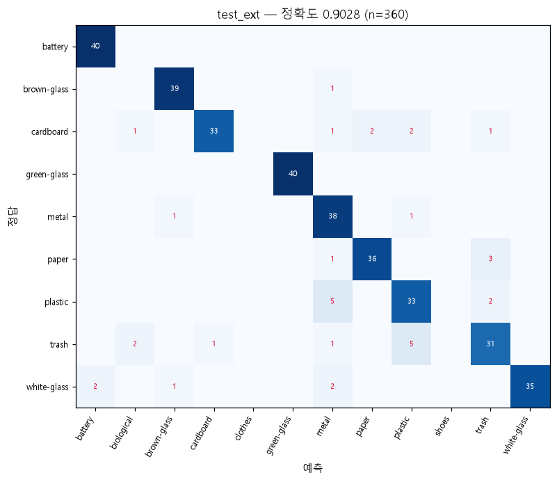
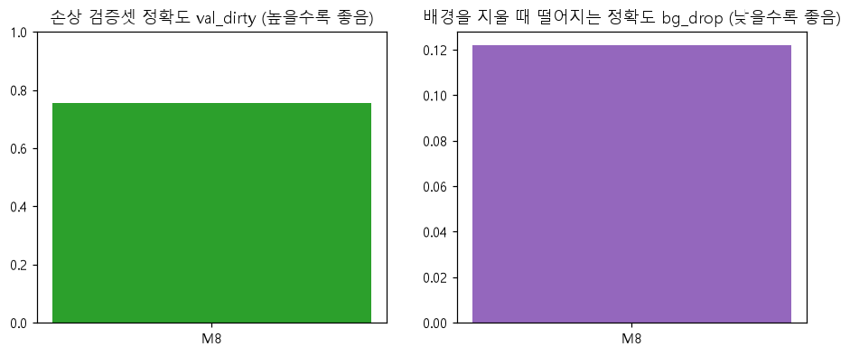

# 쓰레기 이미지 12종 분류 — 해커톤 보고서

> 사진 한 장을 12개 쓰레기 클래스 중 하나로 분류한다. **사전학습 모델 없이**, `torch.nn`으로 직접 만든 작은 ResNet을 처음부터 학습했다.

## 0. 요약

| 항목 | 내용 |
|---|---|
| 클래스 (12) | battery, biological, brown-glass, cardboard, clothes, green-glass, metal, paper, plastic, shoes, trash, white-glass |
| 모델 | SmallResNet (폭 48, 4단계 × BasicBlock 2개, 파라미터 6,289,212개), 입력 128×128, 사전학습 없음 |
| 학습 데이터 | 9개 출처를 정리·혼합한 27,050장 |
| 튜닝 | 한 번에 하나씩 바꾸는 실험 사다리 3차례 (1차 R1~R12, 2차 M1~M9, 3차 N1·N2) |
| 최종 모델 | **M8** (2차 사다리) — `01_coding/model/` |
| **TEST 정확도** | **test 0.8823** (Kaggle 원본 2,328장) / **test_ext 0.9028** (외부 실사 360장) |
| 더러운 사진 추가 평가 | 0.773 (원본 0.826 / 손상 0.720, 1,200장) |

> 3차 사다리(N1·N2, 노이즈·배경 강건성)는 진행 중이다. 결과가 M8보다 좋으면 이 문서와 `01_coding/model/`을 갱신한다.

### 저장소 구조
| 경로 | 내용 |
|---|---|
| `01_coding/notebooks/final_model.ipynb` | **분석 전 과정**: 데이터 분할·통합·정리 → 전처리·증강 → 모델 → 학습 → 튜닝 사다리 → 최종 평가 → 결론 (출력 포함) |
| `01_coding/notebooks/test.ipynb` | **최종 모델 성능 확인만**: TEST 정확도·혼동행렬·클래스별 정밀도/재현율 |
| `01_coding/model/` | 최종 가중치 `final_model.pth`, 설정 `config.json`, 모델 설명 `README.md` |
| `01_coding/RESULT/data_split/` | 학습·검증·테스트 사진 목록 CSV (이미지 자체는 Google Drive) |
| `01_coding/RESULT/experiments/` | 모든 실험의 설정·학습 기록·지표 (`ladder*.csv`, `R*/`, `M*/`, `N*/`) |
| `01_coding/RESULT/final_test/` | TEST 1회 평가 결과·혼동행렬, 더러운 사진 평가 예측 |
| `01_coding/RESULT/figures/` | 이 보고서의 그림 |
| `01_coding/tools/` | 데이터 수집·정리 스크립트 (기록용, 원본 196GB가 있어야 실행됨) |

**실행 방법**: Colab에서 노트북만 열고 위에서부터 실행하면 Google Drive 공개 폴더에서 데이터를 받는다. 로컬은 `01_coding/notebooks/`에서 실행. 성능만 보려면 `test.ipynb`.

---

## 1. 과제와 규칙
- 평가 지표: Accuracy. 원본 데이터: Kaggle *Garbage Classification (12 classes)* 15,515장.
- **사전학습 가중치 미세조정 금지** → `torchvision.models`·사전학습 가중치를 쓰지 않고, 모델을 직접 구현해 처음부터 학습. (초기에 ImageNet 사전학습 ResNet18로 진행한 연구는 규칙 확인 후 전부 폐기했다. 그 모델은 TEST를 한 번 본 뒤 폐기됐고 모델 선택에는 쓰이지 않았다.)
- TEST는 실험·모델 선택이 모두 끝난 뒤 **최종 모델로 1회만** 평가한다.

## 2. 데이터

### 2-1. 출처
| 데이터셋 | 출처 · 라이선스 | 사용 범위 | 학습 장수 |
|---|---|---|---|
| Garbage Classification (12 classes) — **원본** | Kaggle `mostafaabla/garbage-classification` | 12클래스. 고정 분할 70/15/15 (seed 42) | 9,584 |
| AI Hub 「재활용품 분류 및 선별 데이터」 직접 촬영 | AI Hub 이용약관 (재배포 금지 → 저장소·공개 링크에 이미지 미포함) | battery, 유리병 3색, metal(캔). 여러 물체가 찍힌 영상 추출 이미지는 제외 | 5,320 |
| RealWaste | UCI ML Repository, CC BY-NC-SA 4.0 (Single et al., 2023) | cardboard, metal, paper, plastic, biological(Food Organics), trash(Misc) | 2,887 |
| TrashBusters/combined — TriCascade | Hugging Face, MIT | biological(음식), cardboard, paper(신문), plastic | 2,645 |
| Recyclable and Household Waste | Kaggle `alistairking` (라이선스 미표기) | 실제 환경 1,830 + 기본 배경 1,014: 스티로폼(trash), 플라스틱 용기, 골판지, 신문, 옷·신발 등 (사진을 보고 고름) | 2,844 |
| Garbage Classification V2 | Kaggle `sumn2u` | metal, paper, plastic, trash, biological (원본과 중복 약 70% 제거, cardboard 제외) | 1,640 |
| ShoeSandalBoot | Hugging Face `Andyrasika` (라이선스 미표기, 학습에만 사용) | shoes | 1,631 |
| TrashBusters — 다양한 금속 | Hugging Face, MIT | metal (캔 이외: 냄비·호일·스프레이 캔) | 474 |
| clothing-dataset-small | GitHub `alexeygrigorev`, CC0 | 대부분 원본과 중복 → 25장만 남음 | 25 |

### 2-2. 클래스별 학습 데이터 구성 (27,050장)

| 클래스 | 장수 | 클래스 | 장수 | 클래스 | 장수 |
|---|---|---|---|---|---|
| clothes | 3,000 | plastic | 2,605 | green-glass | 1,506 |
| shoes | 3,000 | metal | 2,528 | brown-glass | 1,404 |
| biological | 2,689 | paper | 2,522 | trash | 1,580 |
| battery | 2,661 | cardboard | 2,300 | white-glass | 1,255 |

- 원본 Kaggle만 쓰면 클래스 불균형이 8.8배(clothes 5,325 vs brown-glass 607)였는데, 외부 데이터를 더해 **최대·최소 비율 2.4배**로 줄였다.
- 외부 데이터 비율: Kaggle 35% : 외부 65%.

### 2-3. 정리·중복 제거
- 외부 사진은 perceptual hash(hamming ≤ 4)로 Kaggle 전체(train·val·test)와 외부끼리 비교해 **같은 사진·라벨 충돌을 제거**했다.
- 사진을 직접 확인해 라벨과 맞지 않는 사진을 뺐다: AI Hub 유리병 중 병이 너무 작거나 색이 라벨과 다른 사진, V2 cardboard 전체(우유팩·플라스틱 섞임), 육안으로 고른 제외 목록.
- trash에는 외부에서 스티로폼 컵·용기만 더했다(Kaggle trash는 마스크·칫솔·기저귀).

### 2-4. 평가셋
| 셋 | 장수 | 구성 | 용도 |
|---|---|---|---|
| val | 2,327 | Kaggle 원본 검증 15% | 조기 종료·모델 선택 |
| val_ext | 498 | 외부 실사 (RealWaste 273 · AI Hub 225, 10클래스) | 모델 선택 (다른 촬영 환경) |
| val_hard | 1,198 | val 700 + val_ext 498에 흐림·어둡게·빛번짐 | 모델 선택 (어려운 사진) |
| val_dirty | 1,198 | val_hard 원본에 8가지 손상(약·강) | 3차 사다리 선택 |
| **test** | **2,328** | Kaggle 원본 테스트 15% | **최종 1회** |
| **test_ext** | **360** | 외부 실사 (AI Hub 180 · RealWaste 180, 9클래스) | **최종 1회** |
| test_dirty | 1,200 | 학습한 종류의 물체만, 클래스당 Kaggle test 40~100 + 외부 0~60, 절반 손상 | 추가 평가 1회 |

모델 선택 지표: **val_avg = (val + val_ext + val_hard) / 3** (3차는 val_dirty까지 넣은 val_avg4).

## 3. 전처리·증강
- 전처리(학습·평가 공통): RGB로 읽어 192×192로 줄임(비율 유지 안 함) → 128×128 → 정규화(학습 데이터 평균 [0.6448, 0.6212, 0.5932], 표준편차 [0.2607, 0.2642, 0.2837]).
- 최종 모델의 증강(학습 때만, 매 epoch 무작위): 좌우 반전(p 0.5), 상하 반전(p 0.5), 회전 ±20°, 어둡게(밝기 30~100%) 또는 흐림(Gaussian σ 0.5~2) 중 하나(p 0.5).
- 무작위 자르기는 물체가 잘릴 수 있어 쓰지 않았다. 비율 유지(letterbox)·색 변화·TrivialAugmentWide는 실험했지만 기각했다(5절).

## 4. 모델
| 부분 | 내용 | 출력 채널 |
|---|---|---|
| 줄기 | 3×3 합성곱(stride 2) + BatchNorm + ReLU | 48 |
| 1~4단계 | BasicBlock × 2씩 (2~4단계 첫 블록 stride 2) | 48 → 96 → 192 → 384 |
| 헤드 | 전역 평균 풀링 → Linear(384 → 12) | 12 |

- BasicBlock = 3×3 합성곱 2개 + BatchNorm + 지름길(크기·채널이 바뀌면 1×1 합성곱). He 초기화. 파라미터 6,289,212개.
- 학습: AdamW(lr 0.001, weight decay 0.0001), batch 64, cosine 학습률, CrossEntropy, 혼합 정밀도(GPU), seed 42. 최대 60 epoch, 조기 종료 patience 10(기준 (val + val_ext)/2), 최고 epoch의 가중치를 저장.

## 5. 하이퍼파라미터 튜닝 과정
한 단계에 한 가지만 바꾸고, 선택 지표가 현재 최고보다 **+0.01 이상** 오르면 채택했다.

### 1차 (R1~R12, 정리 전 데이터 12,000장) — 최고 R9 val_avg 0.502
| 단계 | 바꾼 것 | val | val_ext | val_hard | val_avg | 판정 |
|---|---|---|---|---|---|---|
| R1 | 기준 (Kaggle만, 128px, 폭 32, 30 epoch) | 0.789 | 0.144 | 0.341 | 0.425 | 채택 |
| R2 | 외부 데이터 혼합 | 0.746 | 0.772 | 0.478 | 0.666 | 기각 (당시 clothes·shoes 조건) |
| R3 | 어둡게·흐림 증강 | 0.789 | 0.154 | 0.402 | 0.448 | 채택 |
| R5 | cosine 학습률 | 0.803 | 0.156 | 0.506 | 0.488 | 채택 |
| R9 | 모델 폭 48 | 0.816 | 0.184 | 0.506 | 0.502 | 채택 |
| R4·R6~R8·R10~R12 | 무작위 자르기, epoch 60·100, MLP 헤드, 160px, lr 3e-3, wd 5e-4 | | | | ≤ 0.498 | 기각 |

→ **외부 사진을 학습하지 않으면 외부 사진 정확도가 0.14~0.18**에 그쳤다. 데이터를 정리·확장한 뒤 2차를 진행했다.

### 2차 (M1~M9, 정리한 데이터 27,050장) — 최종 M8 val_avg 0.877
| 단계 | 바꾼 것 | val | val_ext | val_hard | val_avg | 판정 |
|---|---|---|---|---|---|---|
| M1 | 정리한 혼합 데이터 | 0.834 | 0.839 | 0.766 | 0.813 | 채택 |
| M2 | 비율 유지(letterbox) | 0.850 | 0.839 | 0.640 | 0.776 | 기각 |
| M3 | 좌우·상하 반전, 회전 | 0.859 | 0.900 | 0.786 | 0.848 | 채택 |
| M4 | 밝기·색 변화 | 0.856 | 0.894 | 0.785 | 0.845 | 기각 |
| M5 | TrivialAugmentWide | 0.838 | 0.884 | 0.787 | 0.836 | 기각 |
| M6 | 클래스 가중치 | 0.853 | 0.896 | 0.777 | 0.842 | 기각 |
| M7 | 라벨 스무딩 0.1 | 0.869 | 0.908 | 0.793 | 0.857 | 기각 (+0.008) |
| **M8** | **epoch 30 → 60** | **0.879** | **0.922** | **0.830** | **0.877** | **채택 → 최종** |
| M9 | 입력 160px | 0.885 | 0.914 | 0.782 | 0.860 | 기각 |

**무엇이 효과가 있었나**
1. **데이터**가 가장 컸다: 외부 실사 사진을 섞고 라벨이 틀린 사진을 걸러내자 val_ext 0.18 → 0.84.
2. 방향을 바꾸는 증강(반전·회전)은 효과가 있었고(+0.035), 색 변화·강한 무작위 변형은 이득이 없었다.
3. 30 epoch은 부족했다(30 epoch 실험들은 마지막 epoch이 최고). 60 epoch에서 세 지표가 모두 올랐다(val_hard +0.043).
4. 비율 유지는 흐림·어두운 사진(val_hard 0.766 → 0.640)에서, 160px는 흐림 사진(0.81 → 0.69)에서 손해였다.

### 3차 (N1·N2, M8에서 출발, 진행 중)
- 목적: 노이즈에 강하고 배경에 덜 기대는 모델. 선택 지표 val_avg4 = (val + val_ext + val_hard + val_dirty) / 4.
- **N1** = M8 + 손상 증강(잡음·JPEG·빛번짐·얼룩·저조도 중 하나, p 0.5)
- **N2** = N1 + 배경 교란: 사진마다 물체 상자를 추정해 상자 바깥을 다른 학습 사진의 배경·잡음·흐림·단색으로 60~90% 섞는다. **클래스·출처와 무관하게 모든 사진에 같은 확률**로 걸어, 교란 자체가 정답 힌트가 되지 않게 했다.
- M8 기준값: val_dirty 0.755, val_avg4 0.847, 배경 의존도(배경을 회색으로 지울 때 떨어지는 정확도) 0.122.

## 6. 최종 모델 학습 곡선 · 과적합 점검

- 저장 epoch 50: train 0.982 / val 0.879 (차이 0.10). val loss는 epoch 26(0.477)에서 가장 낮고 이후 조금 오름(epoch 50 0.537).
- val 정확도는 0.87~0.88을 유지 → **가벼운 과적합**(틀린 사진을 지나치게 확신). 정확도가 가장 좋은 epoch의 가중치를 쓴다.
- 과적합 억제: 데이터 다양화, 증강, weight decay, BatchNorm, 전역 평균 풀링(작은 헤드), 조기 종료·최고 epoch 저장. Dropout은 쓰지 않았다(MLP 헤드 R8이 이득 없음).

## 7. TEST 결과 (최종 모델 M8, 1회 평가)
| 셋 | 장수 | 정확도 |
|---|---|---|
| val / val_ext / val_hard | 2,327 / 498 / 1,198 | 0.879 / 0.922 / 0.830 |
| **test** | 2,328 | **0.8823** |
| **test_ext** | 360 | **0.9028** |

- 검증과 TEST가 비슷하다(test 0.882 vs val 0.879, test_ext 0.903 vs val_ext 0.922) → 검증셋에 맞춘 과적합은 작다.
- 클래스별 재현율을 똑같이 평균하면 0.868 → clothes(34%)가 점수를 크게 부풀리지 않았다.
- 약한 클래스와 주요 혼동: white-glass → plastic(16장, 투명 유리 vs 투명 플라스틱), battery → metal(8장), clothes ↔ shoes(16·12장), trash → plastic(test_ext 5장). metal은 정밀도가 낮다(다른 물체를 metal로 예측).
- 출처별: AI Hub 클래스는 160장 중 154장, RealWaste 클래스(매립지 실사)는 160장 중 133장(0.83).

## 8. 강건성 — 더러운 사진·배경

- 학습한 종류의 물체만 쓰고 어려움은 손상으로만 준 1,200장 평가: **0.773** (원본 0.826 / 손상 0.720, 같은 사진 집단에서 -10.6%p).
- 학습 증강에 있던 어둡게·흔들림에는 버티지만, 학습에 없던 **강한 빛번짐(0.28)·저조도+잡음(0.51)·얼룩(0.60)** 에 약하다 → 3차 사다리의 근거.
- 배경 의존도: 물체 상자 바깥을 회색으로 지우면 val·val_ext 정확도가 0.122 떨어진다(배경 단서를 꽤 쓴다).

## 9. 한계와 향후 과제
- seed 하나로 실험해 0.01 이내 차이는 우연과 구분하기 어렵다. 검증셋으로 채택과 최고 epoch을 함께 골라 검증 점수는 조금 낙관적이다.
- 한 출처 비중이 큰 클래스: battery·유리(AI Hub 57~75%, 아스팔트 배경), shoes(흰 배경 제품 사진 54%), clothes(Kaggle 95%).
- paper 학습 데이터의 75~80%가 글자 인쇄물이라, 글자 없는 종이는 정확도가 약 8.6%p 낮다(검증 사진 0.950 vs 0.864). → 글자 없는 종이 데이터 보강.
- AI Hub 라벨에는 물건 번호가 없어, 같은 물건을 다른 날 찍은 사진이 학습과 평가에 함께 있을 수 있다.
- test_ext·더러운 사진 평가에 biological·clothes·shoes 외부 사진이 적거나 없다.

## 10. 재현
1. Colab(GPU)에서 `01_coding/notebooks/final_model.ipynb`를 열고 실행 → Google Drive 공개 폴더(`19R4yPCNI2B204UuINfGlBx4IZ7N2j9XB`)에서 데이터 zip을 받아 `/content`에 푼다. 실험 결과는 저장된 것을 읽고, `RUN_EXPERIMENTS=True`면 끝나지 않은 실험만 학습한다.
2. `01_coding/notebooks/test.ipynb` → 최종 모델의 정확도·혼동행렬.
3. AI Hub 이미지는 이용약관상 재배포할 수 없어 시연 기간에만 공개한다. 없으면 test.ipynb는 test_ext를 저장된 결과로 보여 준다.
